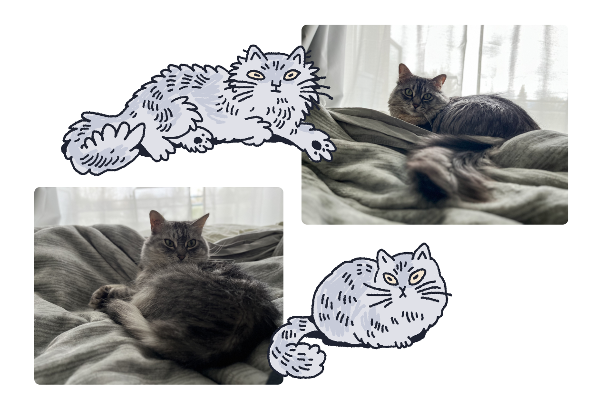

# Hello! :fox_face:

I'm Ris. My pronouns are they/them (English), iel/il (French), 他 (Chinese). I'm a visual communicator who likes to draw, design, animate, code, and eat. Most of the time, you'll likely find me doing a combination of the above.

I am also a full time cat parent to two senior cats.

I specialize in design and code prototyping and co-creation between the design and development disciplines. I have a passion for accessible + inclusive design, building design systems, and integrating design justice and anti-oppression practices into my work. I am also a lifelong learner and advocate of peer mentorship. And sometimes I just like to make silly little things.
